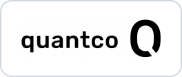
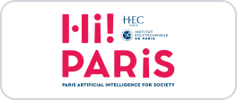
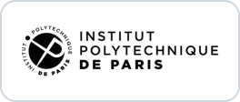

<h1 align="center">Tim Luka Horstmann</h1>

  <strong>AI Applied Scientist at <a href="https://www.quantco.com/">QuantCo</a></strong> 
  Munich, Germany

  <a href="https://horstmann.tech/">Website</a> ·
  <a href="https://scholar.google.com/citations?user=L2i8hH0AAAAJ&amp;hl=en">Google Scholar</a> ·
  <a href="https://www.linkedin.com/in/luka512/">LinkedIn</a> ·
  <a href="mailto:lukahorstmann@gmx.de">Email</a>

I work on applied machine learning, with a focus on language and speech. Before joining QuantCo, I worked on multilingual speech synthesis at Hi! PARIS and NLP for financial regulation at the University of Cambridge.

## Selected work

- **[T-REX](https://github.com/TimLukaHorstmann/T-REX)** — Interactive fact-checking for tables. See which cells support or contradict a claim. [Live demo](https://t-rex.r2.enst.fr/) · [ECML PKDD 2025 paper](https://doi.org/10.1007/978-3-032-06129-4_33)

- **[CosyVoice2-EU](https://github.com/hi-paris/CosyVoice2-EU)** — Zero-shot speech synthesis adapted for French and German. [Audio samples](https://hi-paris.github.io/CosyVoice2-EU/)

- **[Teaching & Research Assistant](https://github.com/hi-paris/teaching-research-assistant)** — A local-first assistant built at Hi! PARIS that combines course materials and web research in cited answers.

- **[MCP Weather](https://github.com/TimLukaHorstmann/mcp-weather)** — A Model Context Protocol server that brings hourly and daily forecasts to MCP clients. [npm package](https://www.npmjs.com/package/@timlukahorstmann/mcp-weather)

## Industry

  
  
  
  

## Research & education

  
  
  
  
  

MPhil in Advanced Computer Science, University of Cambridge · MSc in Data and Artificial Intelligence, Institut Polytechnique de Paris.
